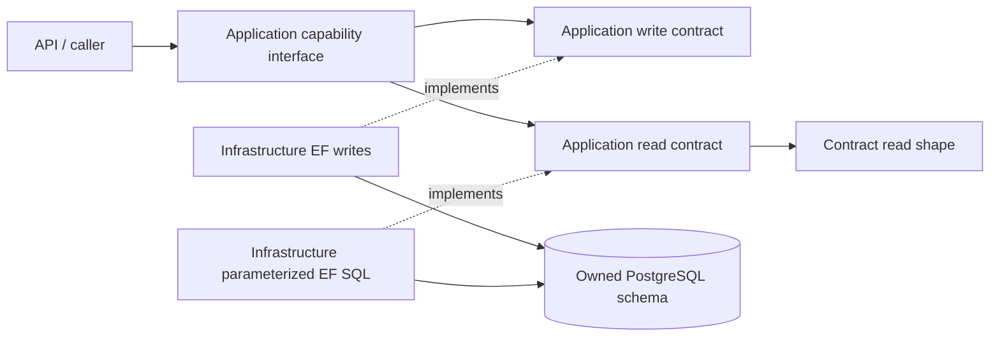

# Anemic direct services on PostgreSQL

[Catalog](README.md) · [Flat service](flat-service.md) · [Delivery](delivery.md)

**Intent:** use capability-oriented Application services for a data-oriented module,
with EF Core writes and SQL-first reads. Choose this when CQS methods keep changes
and retrieval easy to follow. Reconsider a [rich model](modules.md#domain-model)
when invariants need aggregate ownership; reconsider CQRS only after reviewing
responsibilities and coordination. Neither choice follows from deployment topology.

## Compatibility and executable support

The implemented native selection is a flat single-module service, anemic domain,
direct-service flow, EF Core writes, PostgreSQL and parameterized EF raw SQL reads.
It belongs to local package `0.2.0`; [installation and creation preflight](flat-service.md#inputs-and-creation)
requires explicit names, namespaces, selections and fresh destinations. No business
service, repository or endpoint is invented in a production scaffold.

```bash
dotnet new arch-service --name Orders --rootNamespace Acme --layout single \
  --domainModel anemic --applicationFlow direct-service --database postgresql \
  --output src/Orders
```

Run that only after the linked preflight. Omitted profiles or unsupported
CQRS/SQL Server selections fail native validation without files (the engine
may leave an empty output directory). Integrate the new projects using the
[explicit intended-solution route](flat-service.md#explicit-solution-integration).
The [rich/direct-service variation](rich-direct-service.md) selects aggregate behavior
with the same creation route. [Named modules of modular monoliths](modular-monolith.md)
use the anemic/direct-service profile. CQRS, SQL Server and Dapper remain planned.
The broader four-pair architectural compatibility is separate from this evidence.

## Ownership and actual output

The [flat service tree](flat-service.md#output-and-dependency-rules) is the actual
packaged structure. Application supplies guidance for capability interfaces and
acyclic CQS reuse. Domain and Contract begin empty. Infrastructure contains the
module-owned `OrdersDbContext`, typed connection configuration, registration,
readiness check, design-time factory and provider-specific migration directory.
Its context applies only mappings from its own Infrastructure assembly and owns
the `Orders` schema and its migration history. There is no cross-owner table access.



The catalog-only fixture in `tests/fixtures/direct-service` fills these layers:

```text
Acme.Orders.Domain/Reservations/Reservation.cs              # data-only entity
Acme.Orders.Contract/Reservations/ReservationDetails.cs     # separate public read shape
Acme.Orders.Application/Reservations/ReservationsService.cs # IReservations, CQS, write/read contracts
Acme.Orders.Infrastructure/Reservations/ReservationPersistence.cs # EF mapping/store/SQL query
 tests/Acme.Orders.IntegrationTests/PostgreSqlUseCaseTests.cs # public Application seam
```

`IReservations.ReserveAsync` validates positive seats and writes through an
Application-owned persistence contract. `FindAsync` uses a separate Application
read contract returning a Contract shape. Infrastructure implements both; the
composition registers the actual adapters, not mocks. The fixture includes no
HTTP business endpoint. It is catalog verification code outside the package.

## SQL-first reads and LINQ alternative

The fixture passes an interpolated `FormattableString` directly to
`Database.SqlQuery<ReservationDetails>`, with an explicit owned schema, columns
and predicate. EF creates SQL parameters. A reference containing quote/comment
syntax round-trips as data, while a different injection-shaped reference returns
no row. Do not pre-interpolate into a `string`, concatenate user input, or expose
arbitrary table/column identifiers. Queries return response shapes rather than
tracked write entities. Domain richness does not select the read tool.

EF global query filters do not protect unmapped `SqlQuery` results. Include all
applicable owner, resource and tenant predicates explicitly. EF LINQ projections
are a documented alternative: use the owned context with
`AsNoTracking().Where(...).Select(...)`, inspect generated SQL, and return a read
shape. This increment verifies EF SQL-first reads; it does not certify Dapper or
other providers. Query filter semantics and performance depend on the query,
mapping and indexes, not the name of the application-flow profile.

## Local dependencies and configuration

Run/debug inside the solution Dev Container. The generated PostgreSQL Compose
file deliberately contains no workstation port or credential value. Supply
`POSTGRES_PASSWORD` through the invoking environment, then from the system root:

```bash
docker compose -f .devcontainer/compose.yaml -f src/Orders/compose.postgresql.yaml up -d --wait
```

Both files share a Compose network: inside the toolchain, PostgreSQL is
`database:5432`, database/user `Orders`. Inject `Database__ConnectionString` into
the attached toolchain from your secret manager/environment, for example the
shape `Host=database;Database=Orders;Username=Orders;Password=<injected>;Timeout=5`.
The template validates required host/database/username/password and malformed
syntax before startup without printing supplied values. Sensitive EF parameter
logging is disabled. Use verified TLS settings for production and a runtime DML
identity separate from migration DDL permissions. No workload-identity integration
or live credential rotation is claimed. Adopt changed configuration by restart.

PostgreSQL data uses a named volume. Stop this local profile with the same two
`--file` arguments and `down`; add `--volumes` only when deliberately discarding
its disposable database. Multiple services need deliberately named dependencies,
networks and credentials; generation does not rewrite existing Compose files.

## Explicit migrations and checks

From `src/Orders` in the toolchain with external database credentials configured:

```bash
dotnet tool restore
# After adding actual Domain entities and Infrastructure IEntityTypeConfiguration mappings:
dotnet ef migrations add Initial --project Acme.Orders.Infrastructure --context OrdersDbContext --output-dir Persistence/Migrations/PostgreSql
dotnet ef migrations script --idempotent --project Acme.Orders.Infrastructure --context OrdersDbContext --output migrations.sql
# Review the generated migration and SQL, then apply explicitly:
dotnet ef database update --project Acme.Orders.Infrastructure --context OrdersDbContext
Service__Deployment=local dotnet run --project Acme.Orders.API
```

No empty/sample migration is shipped; creating a business model precedes the
first migration. Infrastructure owns the design-time factory, local tool pin,
mappings and migrations. Generation does not restore tools, connect to databases
or run migrations. API startup never changes schema. Production migrations are
an explicit job or reviewed deployment step with a separate identity; provider
substitutions need separate migration sets. Connectivity readiness does not prove
that the deployed schema matches all application expectations.

## Evidence and limits

```bash
ARCH_TEST_CONTAINERS=1 python3 -m unittest discover -s tests -p test_persistence.py -v
```

The named fixture installs the actual package, selects the explicit profile,
adds catalog-owned capability files, and starts the **generated** Compose database
with an ephemeral secret and loopback-only test port. It restores the local EF
tool, creates a real migration, emits idempotent SQL, applies it, and exercises:

- Public Application write/read behavior through real DI and PostgreSQL adapters.
- Positive-seats rejection and canceled work leaving no committed record.
- Parameterized SQL and read shapes through a fresh scope/context.
- Independently observed committed state through Npgsql and PostgreSQL itself.
- Database-ready HTTP health and migration rollback removing the fixture table.

Generated host tests separately prove invalid configuration refusal, unavailable
database readiness while liveness stays healthy, and stopping-host readiness.
The [operational fixture](flat-service.md#evidence-and-limits) proves request
budgets, shutdown cancellation, JSON logs and OCI lifecycle. CI enables container
checks. Domain-unit scaffolding is empty until meaningful domain behavior exists.

Evidence covers Linux/Docker, the pinned .NET 10 graph and PostgreSQL 18 image.
It does not certify authentication/authorization (owned by #64), durable facts,
CQRS, other providers, managed production infrastructure, agent actions or a
complete system baseline. Dependency pins and direct/transitive licenses are in
[the increment review](../dependencies/service-increment.md).

Sources: [persistence decision](https://github.com/lewan0996/arch-patterns/issues/7#issuecomment-5751875474),
[application flow](https://github.com/lewan0996/arch-patterns/issues/18#issuecomment-5849516623),
[EF SQL queries](https://learn.microsoft.com/en-us/ef/core/querying/sql-queries),
[EF migration deployment](https://learn.microsoft.com/en-us/ef/core/managing-schemas/migrations/applying),
[Npgsql EF provider](https://www.npgsql.org/efcore/),
[implementation #58](https://github.com/lewan0996/arch-patterns/issues/58).
