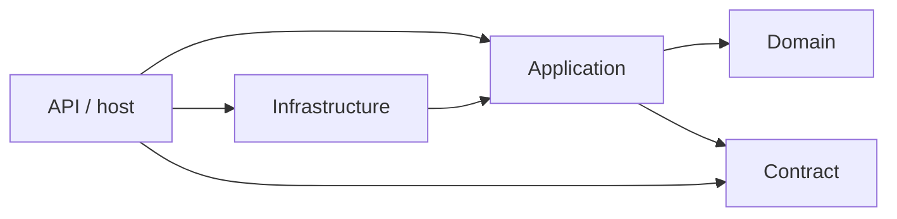

# Create a flat single-module service

[Catalog](README.md) · [Selection route](selection.md) · [Delivery](delivery.md)

**Intent:** keep one module and its host together in one deployable. Choose this
when named internal modules would add no useful ownership boundary. Reconsider a
[modular service](structure.md#deployable-layout) when multiple modules need their
own contracts and data within one deployment. Adding a module requires explicit
manual conversion first; no conversion or module generator is included here.
Domain richness and application flow are independent architecture decisions.

## Inputs and creation

Use the same locally built `ArchPatterns.Templates` package and disposable CLI
home as [solution creation](microservices-solution.md). `arch-service` implements
only `--layout single` (also the native default), with explicit `--domainModel anemic` or `--domainModel rich`,
`--applicationFlow direct-service` and `--database postgresql`. See the
[PostgreSQL profile and migration route](direct-service-postgresql.md) and
[rich/direct-service variation](rich-direct-service.md). Namespace prefixes and names
use the same ASCII PascalCase rules as the solution. Choose a unique service
name, explicit prefix and fresh output; never use `--force`. These validations
are caller prerequisites, not promises made by the native template engine.

From the intended system directory, use this preflight before every invocation:

```bash
(
  set -eu
  service_name=Orders
  root_namespace=Acme
  layout=single
  domain_model=anemic
  application_flow=direct-service
  database=postgresql
  intended_solution="$PWD/Commerce.slnx"
  destination="$PWD/src/Orders"
  [[ "$service_name" =~ ^[A-Z][A-Za-z0-9]*$ ]] || exit 1
  [[ "$root_namespace" =~ ^[A-Z][A-Za-z0-9]*(\.[A-Z][A-Za-z0-9]*)*$ ]] || exit 1
  [[ ( "$domain_model" == anemic || "$domain_model" == rich ) && "$application_flow" == direct-service && "$database" == postgresql ]] || exit 1
  [[ "$layout" == single ]] || { echo 'Unsupported layout' >&2; exit 1; }
  [[ -f "$intended_solution" ]] || { echo 'Select an existing intended solution' >&2; exit 1; }
  dotnet sln "$intended_solution" list >/dev/null
  if [[ -e "$destination" || -L "$destination" ]]; then
    echo "Destination already exists: $destination" >&2
    exit 1
  fi
  if [[ -n "$(find "$PWD" -name "$root_namespace.$service_name.*.csproj" -print -quit)" ]]; then
    echo 'Service/project identity collision in this system' >&2
    exit 1
  fi
  dotnet new arch-service --name "$service_name" --rootNamespace "$root_namespace" \
    --layout "$layout" --domainModel "$domain_model" --applicationFlow "$application_flow" \
    --database "$database" --output "$destination"
)
```

An empty directory or dangling symlink is occupied. Missing required native
inputs can leave an empty output directory. After any failure inspect/report
partial work and resolve it explicitly; no force overwrite or automatic cleanup.
Unsupported layouts fail native choice validation. Namespace/name validity,
identity collisions and occupied destinations are checked by the published caller
preflight; raw `dotnet new` does not enforce these cross-invocation rules.

## Output and dependency rules

```text
src/Orders/
  Directory.Build.props                         # .NET 10, nullable, warnings as errors
  Acme.Orders.API/                               # endpoints, transport DTOs, startup/composition
    Acme.Orders.API.csproj
    Program.cs                                  # JSON logs, validation, budgets, probes
    ServiceOptions.cs                           # typed external host configuration
    LifecycleHealthCheck.cs                     # readiness tracks host lifecycle
  Acme.Orders.Application/Acme.Orders.Application.csproj   # use cases and required interfaces
  Acme.Orders.Domain/Acme.Orders.Domain.csproj             # domain model/behavior
  Acme.Orders.Infrastructure/                    # PostgreSQL adapters, assembly-scanned mappings
    Acme.Orders.Infrastructure.csproj
    PersistenceRegistration.cs
    Persistence/
      OrdersDbContext.cs                        # owns Orders schema
      OrdersDbContextFactory.cs                 # explicit EF tool entry point
      DatabaseOptions.cs                        # validates external credentials
      DatabaseHealthCheck.cs                    # bounded database readiness
      Migrations/PostgreSql/README.md            # real model/migration creation instructions
  Acme.Orders.Contract/Acme.Orders.Contract.csproj         # public messages and read shapes
  tests/
    Acme.Orders.Domain.UnitTests/                 # project + guidance; no invented tests
    Acme.Orders.IntegrationTests/                 # project + HostTests.cs
    Acme.Orders.ArchitectureTests/                # project + DependencyTests.cs
  .config/dotnet-tools.json                      # local, pinned dotnet-ef
  compose.postgresql.yaml                       # external credentials, private Compose dependency
  Dockerfile                                    # multi-stage publish, non-root runtime
  .dockerignore                                 # excludes build output and local secrets
  README.md                                     # exact integration and operational steps
```



Infrastructure can also reference Domain when mappings require it. API's
Infrastructure reference is for composition. Contract depends on no implementation
layer; endpoint transport DTOs belong to API. There is no `Modules` folder or
separate host. Domain has no sample business objects, and the unit test project
has no placeholder passing test. Integration checks exercise real host startup,
configuration refusal, database-unavailable readiness and HTTP liveness. Architecture checks enforce the source
project graph; catalog verification also proves a prohibited reference is caught.

## Explicit solution integration

Generation performs **no solution discovery or post-actions**. This deliberate
manual route behaves identically with intended, adjacent, ancestor, nested,
missing or ambiguous solutions: no existing file is edited. In each case choose
the exact intended solution yourself. If it does not exist, explicitly create it
with ordinary tooling before adding projects. Existing hosts, configuration and
selection records are outside this native invocation's write boundary.

```bash
# From Commerce, after generation and before building:
dotnet sln Commerce.slnx add src/Orders/Acme.Orders.*/*.csproj src/Orders/tests/*/*.csproj
dotnet restore Commerce.slnx
dotnet build Commerce.slnx --no-restore
dotnet test src/Orders/tests/Acme.Orders.IntegrationTests --no-build
dotnet test src/Orders/tests/Acme.Orders.ArchitectureTests --no-build
# Inject Database__ConnectionString externally before running.
Service__Deployment=local dotnet run --project src/Orders/Acme.Orders.API
```

The explicit `sln add` is the sole integration edit and adds all eight projects to
the selected solution. No restore or script runs automatically at generation.
Run/debug using the solution's Dev Container, with Compose supplying runtime
dependencies as those capabilities are selected. The [PostgreSQL profile](direct-service-postgresql.md) explains the explicit Compose
merge, external credentials and migration workflow.

## Operational behavior

`Service__Deployment` labels the structured startup log and must be nonempty. `Service__RequestTimeoutSeconds` and
`Service__ShutdownTimeoutSeconds` must be 1–300, defaulting to 30 and 15.
Configuration binds to typed options and validates before startup. Listening
addresses use ASP.NET Core's external configuration. Changes require a restart
or replacement. The PostgreSQL connection string requires externally supplied credentials; inject
adapter secrets externally and never write them to source, logs or image layers.

The host uses JSON `ILogger` output. `/health/live` checks only responsiveness;
`/health/ready` checks host lifecycle and owned database connectivity, with a
three-second database check budget. It is unhealthy during stopping or database failure.
Readiness is distinct from liveness and dependency checks contribute only to readiness. SIGTERM triggers Kestrel draining, rejects new business traffic,
and cancels in-flight work. Endpoints/adapters must propagate `RequestAborted` to
all asynchronous work. One linked token applies client cancellation, shutdown
and the request budget; budget expiry before headers yields 504, shutdown yields
503. Already-started canceled responses are aborted. Shutdown has its own finite
host budget; platform termination grace must exceed it and routing must honor
readiness. No executable replication or scaling profile is implied.

```bash
# Standalone OCI smoke run from src/Orders, separate from the Dev Container profile.
# Supply POSTGRES_PASSWORD and Database__ConnectionString externally first.
# Connection string shape: Host=database;Database=Orders;Username=Orders;Password=<injected>;Timeout=5
docker compose --project-name orders --file compose.postgresql.yaml up -d --wait
docker build -t orders .
docker run --rm --network orders_default -p 8080:8080 \
  -e Service__Deployment=local -e Database__ConnectionString orders
# In another terminal: curl --fail http://localhost:8080/health/ready
# docker stop --time 20 <container-id>
```

The explicit project name gives this smoke profile the `orders_default` network;
`database` resolves only on that network. The Dev Container profile uses its own
shared network instead. Stop the smoke database with the same project/file
arguments and `down`; use `--volumes` only to discard disposable data.

The OCI artifact uses the pinned .NET toolchain/runtime and runs as a non-root
user. It contains no business endpoints, authorization, outbound HTTP clients,
dispatch or messaging. These remain later capabilities. Build/runtime pins and
licensing are recorded in the [dependency review](../dependencies/service-increment.md).

## Evidence and limits

Catalog-owned installed-package fixtures build actual generated projects, run
their meaningful checks, compare pre-existing files, execute the published
preflight, inject a forbidden project reference, and exercise real request-budget
and SIGTERM cancellation through temporary catalog-only HTTP endpoints. Those
endpoints are never packaged. Opt-in OCI tests build/run the unmodified generated
image, prove missing-config startup refusal, database credential refusal, successful readiness against real PostgreSQL on the
explicit shared Compose network, and clean stop.

```bash
ARCH_TEST_CONTAINERS=1 python3 -m unittest discover -s tests -p test_services.py -v
```

This proves the flat operational scaffold on the exercised Linux/Docker/.NET 10
profile. It does not certify every architecture combination, production platform,
Dev Containers editor debugging or agent-client action. The empty Domain test
project is not runtime evidence.

Sources: [layout contract](https://github.com/lewan0996/arch-patterns/issues/28#issuecomment-6002994331),
[layer ownership](https://github.com/lewan0996/arch-patterns/issues/8#issuecomment-5752067211),
[operations](https://github.com/lewan0996/arch-patterns/issues/12),
[ASP.NET health probes](https://learn.microsoft.com/en-us/aspnet/core/host-and-deploy/health-checks?view=aspnetcore-10.0),
[integration testing](https://learn.microsoft.com/en-us/aspnet/core/test/integration-tests?view=aspnetcore-10.0),
[implementation #57](https://github.com/lewan0996/arch-patterns/issues/57).
