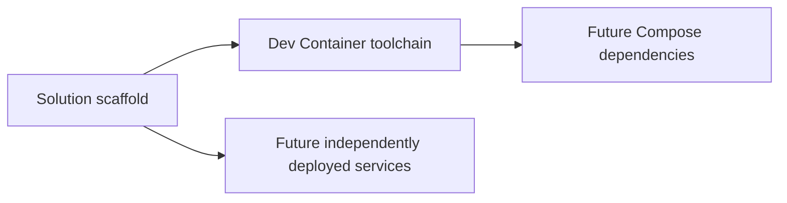

# Create a microservices solution

[Catalog](README.md) · [Selection route](selection.md) · [Delivery](delivery.md)

**Intent:** start a system whose services will be independently deployable. Choose this when independent release, scaling or fault boundaries justify the operational cost. Reconsider a [modular monolith](structure.md#system-composition) when shared deployment is sufficient. Domain richness and application flow remain independent, module-owned decisions.

## Package increment

`ArchPatterns.Templates` version `0.3.0` contains `arch-solution` with the single implemented composition `microservices`. It also provides [flat service creation](flat-service.md) with [PostgreSQL direct-service persistence](direct-service-postgresql.md). The remaining composition and three entry points are planned in the [delivery inventory](delivery.md#creation-chains). Later tickets extend this package. There is no generation wrapper.

Build and install the local artifact from the catalog checkout **inside a Dev Container** with .NET SDK `10.0.401`. Keep installation disposable even there; do not install templates globally on the workstation:

```bash
export DOTNET_CLI_HOME="$(mktemp -d)"
dotnet pack templates/ArchPatterns.Templates.csproj --configuration Release --output artifacts/packages
dotnet new install ./artifacts/packages/ArchPatterns.Templates.0.3.0.nupkg
dotnet new list arch-
dotnet new arch-solution --help
```

The package is a local artifact; these instructions do not imply publication on NuGet.org. Uninstall inside that same disposable CLI home with `dotnet new uninstall ArchPatterns.Templates`, then discard the temporary home and unset `DOTNET_CLI_HOME` when finished. Use the same CLI home for the following creation command.

## Inputs and caller preflight

Supply `--name` (the system's PascalCase identity), `--rootNamespace` (the C# namespace prefix for future boundaries), explicit `--composition microservices` and an explicit `--output`. Use unique identities and destinations within the intended system. This increment supports ASCII PascalCase names matching `[A-Z][A-Za-z0-9]*` and namespace segments of the same form, separated by dots, for example `Commerce` and `Acme.Commerce`.

The native engine rejects missing composition/root namespace and unsupported composition values without generating files. SDK 10.0.401 can still create an empty output directory for missing required inputs: inspect it as partial output and resolve it manually before retrying. Name/namespace conventions, explicit naming/output, cross-invocation compatibility and a nonexistent destination are **caller prerequisites**. `dotnet new` can infer a name and can write into existing directories, including empty ones; it is not the catalog's preflight validator. Do not use `--force`.

Run this Bash preflight from the parent directory before each invocation, changing the values deliberately:

```bash
(
  set -eu
  system_name=Commerce
  root_namespace=Acme.Commerce
  destination="$PWD/Commerce"
  [[ "$system_name" =~ ^[A-Z][A-Za-z0-9]*$ ]] || exit 1
  [[ "$root_namespace" =~ ^[A-Z][A-Za-z0-9]*(\.[A-Z][A-Za-z0-9]*)*$ ]] || exit 1
  if [[ -e "$destination" || -L "$destination" ]]; then
    echo "Destination already exists; choose a fresh path: $destination" >&2
    exit 1
  fi
  dotnet new arch-solution --name "$system_name" \
    --rootNamespace "$root_namespace" --composition microservices \
    --output "$destination"
)
```

This is a documented caller check, not an installed generator. An empty directory or dangling symlink is occupied. Inspect any partial output after failure and handle it manually; rerunning with force or automatic cleanup is outside the contract.

## Output and responsibilities



The solution contains no system-wide application host and no service, module, business code or runtime dependency. It establishes a workspace for later boundary creation. The source tree and check instructions below must track the packaged fixture.

```text
Commerce/
  Commerce.slnx                 # empty intended solution, no application host
  global.json                  # exact SDK, shared by later child projects
  .gitignore                   # build output and local secret files
  README.md                    # identity, namespace, integration/check instructions
  .devcontainer/
    devcontainer.json          # open the workspace through Compose
    compose.yaml               # pinned SDK toolchain; later dependencies join its network
```

Generation has no restore, script or solution-editing post-action. All files go inside the fresh output; adjacent, ancestor and nested existing solutions are not touched. There are no newly generated projects to register. For later service creation, identify the exact solution and follow that capability's verified solution-membership instructions. If native discovery is absent, ambiguous or unintended, use its documented manual path with the explicit solution filename. Never let inferred discovery choose another system's solution.

Open the generated folder with a Dev Containers client. The toolchain service supplies the SDK and will run/debug applications; Compose supplies dependencies as those capabilities arrive. See the generated README for dependency DNS, external configuration, secrets and lifecycle conventions. Starting the toolchain alone does not start a database, broker, identity provider or application. Docker/Compose and a Dev Containers client are workstation prerequisites, outside the template installation.

## Integration and checks

```bash
cd Commerce
dotnet --version
dotnet sln Commerce.slnx list
dotnet restore Commerce.slnx
dotnet build Commerce.slnx --no-restore
```

The empty solution has no projects to restore or compile; MSBuild may warn accordingly. This checks scaffold validity, not application behavior. Continue with [flat service generation and its meaningful checks](flat-service.md). Do not create a placeholder application merely to make this check nonempty.

The catalog's disposable installed-package checks run with Python 3 and the pinned SDK:

```bash
python3 -m unittest discover -s tests -v
```

They exercise discovery/help, required/choice input failures, the documented fresh-folder preflight, host-free output and explicit solution restore/build, and compare existing files around generation. Package installation uses a disposable CLI home and does not change the developer's installed templates. The [dependency review](../dependencies/template-increment.md) states pins, licensing and evidence limits.

**Source decisions:** [native generation](https://github.com/lewan0996/arch-patterns/issues/14#issuecomment-5849731801), [solution/layout amendment](https://github.com/lewan0996/arch-patterns/issues/28#issuecomment-6002994331), [scope review](https://github.com/lewan0996/arch-patterns/issues/38#issuecomment-6894667420), [final Wolverine decision](https://github.com/lewan0996/arch-patterns/issues/52#issuecomment-6900052949) and [implementation #56](https://github.com/lewan0996/arch-patterns/issues/56). This increment introduces no dispatch, persistence or messaging recipe; their retained contracts and deferred capabilities stay on the linked delivery route.
