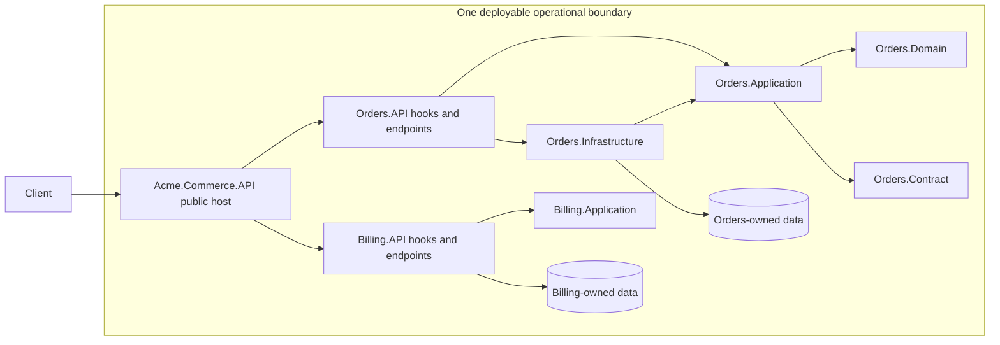

# Create a modular monolith and named modules

[Catalog](README.md) · [Selection route](selection.md) · [Flat service](flat-service.md)

**Intent:** use one public deployable host with independently named internal
modules. Choose this when shared release and operation are appropriate but
capabilities need clear ownership. Reconsider microservices when independent
deployment has a concrete benefit. Domain shape and application flow remain
module choices; neither follows from this topology.

## Supported creation chain

The combined local package `0.3.0` extends the same native package with
`arch-solution --composition modular-monolith` and `arch-module`. This page
verifies named modules selecting anemic/direct-service, EF writes, PostgreSQL
and parameterized EF SQL reads. Other module selections remain unsupported by
this increment. The [flat baseline](direct-service-postgresql.md) explains the
model, read tooling, invariants and migration principles.

Use the [package installation and fresh-solution preflight](microservices-solution.md#package-increment)
inside a disposable CLI home or Dev Container. Select the intended solution name
and namespace, reject an existing destination (even empty or a dangling symlink),
then create it explicitly:

```bash
(
  set -eu
  system_name=Commerce
  root_namespace=Acme
  destination="$PWD/Commerce"
  [[ "$system_name" =~ ^[A-Z][A-Za-z0-9]*$ ]] || exit 1
  [[ "$root_namespace" =~ ^[A-Z][A-Za-z0-9]*(\.[A-Z][A-Za-z0-9]*)*$ ]] || exit 1
  [[ ! -e "$destination" && ! -L "$destination" ]] || { echo 'Destination already exists' >&2; exit 1; }
  dotnet new arch-solution --name "$system_name" --rootNamespace "$root_namespace" \
    --composition modular-monolith --output "$destination"
)
```

This creates `Commerce.slnx` and its public API host under `src/Commerce`.
It deliberately contains no domain/application-flow selection or business
module. Add the initial named module, then each additional module through the
same caller preflight from `Commerce`:

```bash
(
  set -eu
  module_name=Orders
  root_namespace=Acme.Commerce
  domain_model=anemic
  application_flow=direct-service
  database=postgresql
  intended_solution="$PWD/Commerce.slnx"
  host_boundary="$PWD/src/Commerce"
  destination="$host_boundary/Modules/$module_name"
  [[ "$module_name" =~ ^[A-Z][A-Za-z0-9]*$ ]] || exit 1
  [[ "$root_namespace" =~ ^[A-Z][A-Za-z0-9]*(\.[A-Z][A-Za-z0-9]*)*$ ]] || exit 1
  [[ "$domain_model" == anemic && "$application_flow" == direct-service && "$database" == postgresql ]] || exit 1
  [[ -f "$intended_solution" ]] || { echo 'Select an existing intended solution' >&2; exit 1; }
  dotnet sln "$intended_solution" list >/dev/null
  host_project="$host_boundary/$root_namespace.API/$root_namespace.API.csproj"
  [[ -f "$host_project" && -f "$host_boundary/$root_namespace.API/Program.cs" ]] || { echo 'Select the intended modular host' >&2; exit 1; }
  if [[ -d "$host_boundary/$root_namespace.Application" || -d "$host_boundary/$root_namespace.Infrastructure" ]]; then
    echo 'Flat host requires explicit conversion to modular layout before adding a module' >&2
    exit 1
  fi
  [[ ! -e "$destination" && ! -L "$destination" ]] || { echo 'Destination already exists' >&2; exit 1; }
  if [[ -n "$(find "$PWD" -name "$root_namespace.$module_name.*.csproj" -print -quit)" ]]; then
    echo 'Module/project identity collision in this solution' >&2
    exit 1
  fi
  dotnet new arch-module --name "$module_name" --rootNamespace "$root_namespace" \
    --domainModel "$domain_model" --applicationFlow "$application_flow" \
    --database "$database" --output "$destination"
)
```

Use `Billing` instead of `Orders` for the later module. Names are unique within
the host; fully qualified project identities must be unique in the solution.
Namespace prefixes are the actual host prefix, including the host's name.
Native input choice validation rejects missing/unsupported profiles; the caller
checks layout, identities and occupied output. Raw `dotnet new` does not infer
the owning host, enforce collisions, or convert a flat service. Failed validation
may leave an empty output directory; inspect partial work explicitly and never
force overwrite or silently delete it.

## Actual output and ownership

```text
Commerce/
  Commerce.slnx                               # initially contains host and its tests
  global.json                                 # pinned .NET 10 SDK
  .devcontainer/                              # toolchain, not a production host
  src/Commerce/
    Directory.Build.props                     # nullable, .NET 10, warnings as errors
    Acme.Commerce.API/
      Acme.Commerce.API.csproj                 # references only named module APIs
      Program.cs                              # shared middleware, logging, probes, lifecycle
      ServiceOptions.cs
      LifecycleHealthCheck.cs
    Dockerfile                                # publishes the host and composed modules
    .dockerignore
    tests/
      Acme.Commerce.IntegrationTests/HostTests.cs
      Acme.Commerce.ArchitectureTests/DependencyTests.cs
    Modules/
      Orders/
        Directory.Build.props
        Acme.Commerce.Orders.API/              # library, no Program.cs or own process
          ModuleRegistration.cs               # AddOrdersModule / MapOrdersEndpoints
          Acme.Commerce.Orders.API.csproj
        Acme.Commerce.Orders.Application/      # capability interfaces/use cases
        Acme.Commerce.Orders.Domain/           # data-only model in this selection
        Acme.Commerce.Orders.Contract/         # public query responses, separate from DTOs
        Acme.Commerce.Orders.Infrastructure/
          PersistenceRegistration.cs
          Persistence/OrdersDbContext.cs       # Orders schema and own mapping assembly
          Persistence/OrdersDbContextFactory.cs
          Persistence/DatabaseOptions.cs
          Persistence/DatabaseHealthCheck.cs
          Persistence/Migrations/PostgreSql/README.md
        tests/
          Acme.Commerce.Orders.Domain.UnitTests/  # empty until meaningful domain behavior
          Acme.Commerce.Orders.IntegrationTests/ModuleTests.cs
          Acme.Commerce.Orders.ArchitectureTests/DependencyTests.cs
        .config/dotnet-tools.json
        compose.postgresql.yaml               # Orders-database; its own persistent volume
        README.md                             # host reference/hooks, credentials and migrations
      Billing/                                # identical ownership; Billing schema/config/tests
```

The five module projects have the same [inward dependencies](modules.md#responsibilities-and-dependencies)
as the flat baseline. API references Infrastructure only for composition.
The host references module API projects, never their contexts or Application
implementations. Module APIs expose named hooks; they do not start Kestrel, own
process middleware, or package a separate container. Module contexts discover
only their owning Infrastructure assembly's mappings, use separate schemas and
migration histories, and consume independently scoped connection settings.



Modules may expose query contracts for explicitly designed cross-module queries;
consumers never access another owner's context/tables. HTTP DTOs belong to API,
public query responses to Contract. No sample business types/endpoints are
packaged. Shared-host deployment does not imply shared module transactions.
Durable asynchronous facts and authorization/dispatch contributions arrive in
their owning capability tickets; this page makes no messaging or authorization
claim and does not restore deferred cross-module atomicity.

## Deliberate manual integration

Generation never discovers solutions, executes post-actions, or changes an
existing host, configuration or selection record. This holds with intended,
adjacent, ancestor, nested, missing and ambiguous solutions. Select the exact
solution yourself; if missing, explicitly create one before adding projects.
Then from the solution root:

```bash
dotnet sln Commerce.slnx add src/Commerce/Modules/Orders/Acme.Commerce.Orders.*/*.csproj src/Commerce/Modules/Orders/tests/*/*.csproj
dotnet add src/Commerce/Acme.Commerce.API/Acme.Commerce.API.csproj reference src/Commerce/Modules/Orders/Acme.Commerce.Orders.API/Acme.Commerce.Orders.API.csproj
```

Manually add `using Acme.Commerce.Orders.API;` to the host's `Program.cs`, call
`builder.Services.AddOrdersModule(builder.Configuration);` before `builder.Build()`,
and `app.MapOrdersEndpoints();` before `app.RunAsync()`. Repeat the same three
edits and solution-add step for Billing. The hooks wire module-owned persistence
and expose the endpoint mapping location without inventing business endpoints.
Host test configuration must supply each registered module's required settings;
extend host-wide readiness assertions to the selected dependencies. Keep module
integration checks and architecture projects at their owner.

The separate [architecture-selection record](https://github.com/lewan0996/arch-patterns/issues/81)
requires deliberate manual current-state maintenance after successful native
integration. A module invocation never marks itself integrated or updates that
record. Reconcile source/record disagreement explicitly before a later AI action.

## Database and process configuration

Supply `Orders_POSTGRES_PASSWORD` and `Billing_POSTGRES_PASSWORD` externally, then
deliberately merge the dependency files with the Dev Container toolchain:

```bash
docker compose -f .devcontainer/compose.yaml -f src/Commerce/Modules/Orders/compose.postgresql.yaml -f src/Commerce/Modules/Billing/compose.postgresql.yaml up -d --wait
```

Inside the toolchain, use service DNS names `Orders-database` and
`Billing-database` and independently inject `Modules__Orders__Database__ConnectionString`
and `Modules__Billing__Database__ConnectionString`. Each uses its own database/user
matching the module name, plus the externally supplied password, for example the
shape `Host=Orders-database;Database=Orders;Username=Orders;Password=<injected>;Timeout=5`.
No dependency port or credential is published by generation. Modules contribute
uniquely named database readiness checks to the host. Missing/malformed credentials
refuse startup without printing their values. No migrations run on startup.

From each module directory, after adding real entities/mappings and configuring
its module-scoped connection string:

```bash
dotnet tool restore
dotnet ef migrations add Initial --project Acme.Commerce.Orders.Infrastructure --context OrdersDbContext --output-dir Persistence/Migrations/PostgreSql
dotnet ef migrations script --idempotent --project Acme.Commerce.Orders.Infrastructure --context OrdersDbContext --output migrations.sql
dotnet ef database update --project Acme.Commerce.Orders.Infrastructure --context OrdersDbContext
```

Review/apply migrations as explicit operational work with separate production DDL
authority. Use production TLS and runtime DML credentials. Host settings,
structured logs, bounded requests, cancellation, shutdown, restart-on-config-change
and portable image follow the [operational baseline](flat-service.md#operational-behavior).
The host is the operational boundary; modules only contribute signals. Supply
`Service__Deployment` and both module connection settings before running the host.
Build its image with `src/Commerce` as context so the named modules are included.

## Checks and exact evidence

```bash
dotnet restore Commerce.slnx
dotnet build Commerce.slnx --no-restore --warnaserror
dotnet test src/Commerce/Modules/Orders/tests/Acme.Commerce.Orders.IntegrationTests --no-build
dotnet test src/Commerce/Modules/Orders/tests/Acme.Commerce.Orders.ArchitectureTests --no-build
ARCH_TEST_CONTAINERS=1 python3 -m unittest discover -s tests -p test_modules.py -v
```

The last command runs from this catalog checkout. The installed-package fixture
creates the public host, initial and later modules, makes the documented manual
reference/hook edits, restores/builds, and runs meaningful generated host/module
checks. Safety cases cover inputs, output collisions, flat-host refusal,
name collisions, solution ambiguity/manual fallback and preservation of existing
host/configuration/record files. A catalog-only two-module business fixture starts
real PostgreSQL dependencies, creates/applies each module's migration, writes and
queries through the public Application interfaces, maps Contract shapes to
distinct HTTP DTOs through the integrated host, rejects invalid work, checks
readiness, and independently observes committed state and absent foreign schemas.

Evidence covers this Linux/Docker/.NET 10/PostgreSQL chain. It does not certify
modular microservice creation (#60), rich/CQRS named modules, browser sessions,
authorization, facts, broker/provider substitutions, AI edits or a complete
baseline. The [dependency review](../dependencies/service-increment.md) owns the
unchanged framework/provider/image graph. New scaffolds use the already resolved
MIT `Microsoft.AspNetCore.TestHost` package directly for module tests; other test
packages retain their existing MIT/Apache-2.0 terms. No production dependency or
managed-service subscription is added by this slice.

Sources: [module responsibilities](https://github.com/lewan0996/arch-patterns/issues/8#issuecomment-5752067211),
[layout/creation contract](https://github.com/lewan0996/arch-patterns/issues/28#issuecomment-6002994331),
[final integration decision](https://github.com/lewan0996/arch-patterns/issues/52#issuecomment-6900052949),
[implementation #59](https://github.com/lewan0996/arch-patterns/issues/59).
