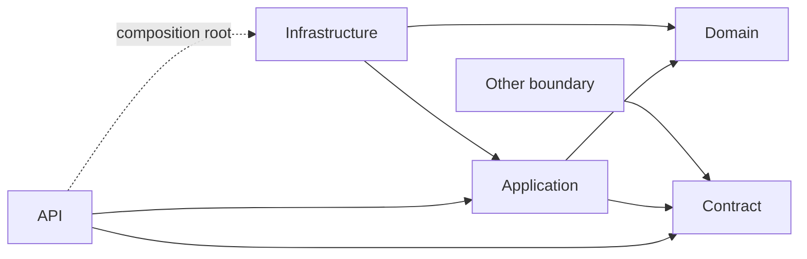

# Module internals

[Catalog](README.md) · [Selection route](selection.md) · Next: [Runtime choices](runtime.md)

## Responsibilities and dependencies

**Intent:** keep each module's behavior and data owned behind its public contract, whether deployed alone or in a shared host. Prefer business-capability/use-case organization within the layers; reconsider grouping when changes to one capability require navigating unrelated technical folders.

| Project | Owns | Boundary constraint |
| --- | --- | --- |
| API | Endpoints, transport DTOs, mapping and composition | Flat API also starts the host; modular host composes named module APIs |
| Application | Use cases, handlers and required interfaces | Depends inward on Domain; owns persistence/read/publication abstractions |
| Domain | Business model, invariants and domain events | No infrastructure or Wolverine dependency |
| Infrastructure | Implementations of external concerns, EF mappings and migrations | Implements Application interfaces; does not become a public integration surface |
| Contract | Public commands, queries, response shapes and integration events | Excludes handlers/internal behavior and Wolverine dependencies |

Dependencies point inward. API references Infrastructure for composition. Consumers use published contracts and boundary adapters, not another module's context, tables or internal implementation. HTTP DTOs and public messages are distinct responsibilities. See the [illustrative project tree](structure.md#deployable-layout); the [flat service page](flat-service.md) supplies its actual project/test tree and integration instructions.

**Compatibility/support:** these responsibilities apply to every retained domain/flow pair. Sources: [structure decision](https://github.com/lewan0996/arch-patterns/issues/6), [module decision](https://github.com/lewan0996/arch-patterns/issues/8), [layout contract](https://github.com/lewan0996/arch-patterns/issues/28#issuecomment-6002994331). [Flat service generation and checks](flat-service.md) are implemented; modular delivery remains planned in [#59](https://github.com/lewan0996/arch-patterns/issues/59).

## Domain model

| Option / module scope | Choose when | Reconsider when | Prerequisites |
| --- | --- | --- | --- |
| Anemic | Data-oriented CRUD has little domain behavior | Invariants become scattered across application operations | Application services own behavior; EF access uses an Application-owned narrow context or repositories |
| Rich | Aggregates encapsulate meaningful business invariants | Mostly data movement does not benefit from aggregate behavior | Application-owned aggregate-root repository contracts; separate read shapes |

Domain shape is independent of topology and invocation. Rich models do not require CQRS. Read models are query shapes, not necessarily domain models. Do not expose aggregates as transport contracts merely to reuse their shape.

**Source and support:** [persistence decision](https://github.com/lewan0996/arch-patterns/issues/7#issuecomment-5751875474); implemented [anemic/direct-service PostgreSQL](direct-service-postgresql.md); implemented [rich/direct-service variation](rich-direct-service.md), and planned [rich/CQRS #63](https://github.com/lewan0996/arch-patterns/issues/63). Follow those tickets for full option pages and meaningful generated checks.

## Application flow

**Intent:** select one consistent module-wide way to invoke and coordinate use cases.

| Option | Choose when | Reconsider when | Compatibility / conflicts |
| --- | --- | --- | --- |
| Direct-service | Capability interfaces and CQS methods keep use cases easy to follow | Service-to-service dependencies obscure execution; review responsibilities first | Reuse is acyclic; protected calls pass module-owned decorators even outside HTTP |
| CQRS | Separate command/query models and isolated handlers clarify responsibilities | Dispatch indirection adds little value or hides orchestration problems | One owning handler per request; no request/handler chaining or external command/query routes |

CQRS uses Wolverine dispatch with explicit allowed-handler registration, missing/duplicate ownership detection and remote invocation disabled. Commands may read their write model for invariants. Shared behavior belongs in Application or Domain services. Contract and Domain remain independent of Wolverine. Direct-service modules keep their Application services and use a narrow publication interface for reliable messaging.

Both paths require [authorization at the use-case boundary](runtime.md#identity-and-authorization). Neither CQRS nor direct-service invocation changes deployment boundaries or permits cross-owner table access.

**Sources and support:** [profile contract](https://github.com/lewan0996/arch-patterns/issues/18#issuecomment-5849516623), controlled by the [final Wolverine decision](https://github.com/lewan0996/arch-patterns/issues/52#issuecomment-6900052949). CQRS generation is planned in [#62](https://github.com/lewan0996/arch-patterns/issues/62) and [#63](https://github.com/lewan0996/arch-patterns/issues/63); no CQRS dispatch/runtime evidence exists in this catalog.

## Compatible combinations

These four combinations are conceptually compatible in a modular monolith, flat service or named module of a modular service. They are not four certified executable profiles.

| Domain / flow | Example or variation | What changes |
| --- | --- | --- |
| Anemic / direct-service | [Verified flat PostgreSQL fixture](direct-service-postgresql.md); both complete baselines remain planned | CRUD behavior in Application capability services |
| Rich / CQRS | Both planned baselines; [#63](https://github.com/lewan0996/arch-patterns/issues/63) | Aggregate behavior, separate reads, explicit Wolverine dispatch/effects |
| Rich / direct-service | [Verified PostgreSQL variation](rich-direct-service.md) | Keep aggregates and separate reads, invoke capability services |
| Anemic / CQRS | Focused variation; [#62](https://github.com/lewan0996/arch-patterns/issues/62) | Keep data-only model, separate requests and isolated handlers |

Compatibility for an arbitrary technology combination remains unresolved until its prerequisites and evidence are established. Continue with [persistence and reads](runtime.md#persistence-and-reads).
