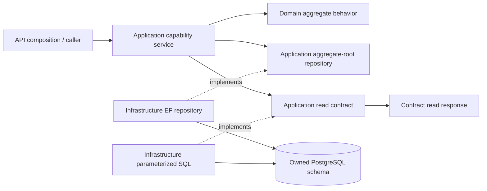

# Rich domain with direct services

[Catalog](README.md) · [Anemic baseline](direct-service-postgresql.md) · [Module choices](modules.md)

**Intent:** keep direct capability-service invocation while aggregates own business
invariants. Choose this when commands change behavior-rich state but separate
command/query dispatch adds little value. Reconsider a rich model for data-only
CRUD; reconsider tangled service responsibilities before selecting CQRS. Domain
richness, application flow and deployment topology remain independent decisions.

## Supported variation and creation

Local package `0.3.0` adds the flat `single` layout with `rich` domain,
`direct-service` application flow, PostgreSQL EF writes and separate EF SQL-first
reads. This is a focused variation of the [anemic PostgreSQL baseline](direct-service-postgresql.md),
using its same five projects, owner-local tests, operational baseline and migration
route. Named modules, rich/CQRS, other database providers, authorization and reliable
facts require their own evidence; this variation does not certify them.

Install the package using the [solution installation route](microservices-solution.md).
Run the [flat-service caller preflight](flat-service.md#inputs-and-creation) with
`domain_model=rich`: validate explicit PascalCase names/root namespace, a distinct
nonexistent destination, project-name uniqueness and the intended solution first.
Then the native invocation is:

```bash
dotnet new arch-service --name Orders --rootNamespace Acme --layout single \
  --domainModel rich --applicationFlow direct-service --database postgresql \
  --output src/Orders
```

Generation writes only fresh output and has no discovery, restore or script
post-actions. Select the intended solution explicitly and follow the baseline's
[manual solution integration](flat-service.md#explicit-solution-integration),
including separate restore, build, architecture and host tests. Occupied output,
including empty directories and dangling symlinks, is refused by the caller
preflight. Inspect/report partial output after failure; never force overwrite.

## What changes from the anemic baseline

The generated production structure remains business-free. The selected
Application and Domain READMEs describe aggregate ownership, repositories and
separate reads; generation does not invent an aggregate, repository, business
service, endpoint or passing unit test. Actual model code follows real requirements.

An Application-owned command-side repository loads and saves aggregate roots.
It does not expose internal entities or read projections. The Application service
coordinates a command, invokes aggregate behavior and commits through that
repository. Query methods use a separate Application-owned read contract returning
Contract response shapes. Infrastructure implements both contracts and owns all
EF mappings, context and explicit provider-specific migrations. API owns transport
DTOs and composition. Contract and Domain remain free of EF and dispatch packages.



The repository's aggregate lookup supports command execution; it is not the
public query API. Keep capability-service reuse acyclic. A separate read shape
uses the same owner's database, with no separate database or projection engine.
The baseline's SQL parameterization and explicit tenant/resource predicate rules
also apply here; raw SQL does not inherit EF global query filters automatically.

## Catalog-owned fixture and checks

The actual fixture under `tests/fixtures/rich-direct-service` adds these files to
the generated boundary; none are included in the NuGet package:

```text
Acme.Orders.Domain/Reservations/Reservation.cs               # aggregate and local domain event
Acme.Orders.Application/Reservations/ReservationsService.cs  # IReservations, root repository and read contracts
Acme.Orders.Contract/Reservations/ReservationDetails.cs      # immutable separate read response
Acme.Orders.Infrastructure/Reservations/ReservationPersistence.cs # EF mapping, root repository, SQL reads
tests/Acme.Orders.Domain.UnitTests/Reservations/ReservationTests.cs # owner-local invariant tests
tests/Acme.Orders.IntegrationTests/Reservations/RichDirectServiceUseCaseTests.cs # public Application seam
```

The illustrative reservation aggregate creates and changes a seat count within
1–8, rejecting invalid changes before mutation. `ChangeSeats` records a
module-owned domain event, and EF maps private state while excluding the event
list. This is a focused catalog example, not a prescribed product model.
The event stays in Domain and in memory; the fixture does not implement a
dispatcher, publication, durable delivery or cross-module transaction.

The unrestricted `IReservations` service is resolved through the actual host DI
composition with a real EF repository and SQL adapter. It creates an aggregate,
loads it in a fresh scope to change its seats, then queries a separate immutable
response in another scope. An Npgsql connection independently observes committed
state. An injection-shaped reference remains data, while another such reference
returns no result. A rejected aggregate change leaves the committed seat count
unchanged. Domain tests exercise aggregate methods rather than private state or
repository implementation details.

```bash
ARCH_TEST_CONTAINERS=1 python3 -m unittest discover -s tests -p test_rich_direct_service.py -v
```

This installs the actual package in a disposable CLI home, generates explicit
rich/direct-service output, builds with warnings as errors, runs owner-local
domain and architecture checks, starts the generated digest-pinned PostgreSQL
Compose dependency with ephemeral external credentials, creates/applies a real
Infrastructure migration and executes the public Application fixture. Cleanup
removes only that fixture's containers and volumes. No new framework/provider/test
dependencies are added beyond the [reviewed baseline graph](../dependencies/service-increment.md).

Evidence covers the exercised Linux/Docker/.NET 10/PostgreSQL profile. Empty
production domain scaffolding is not behavioral evidence. HTTP business endpoints,
protected use cases, CQRS, other providers, durable facts, client actions and
complete system baselines have separate capability tickets and checks.

Sources: [persistence and aggregate-root repository decision](https://github.com/lewan0996/arch-patterns/issues/7#issuecomment-5751875474),
[application-flow contract](https://github.com/lewan0996/arch-patterns/issues/18#issuecomment-5849516623),
[implementation #61](https://github.com/lewan0996/arch-patterns/issues/61).
