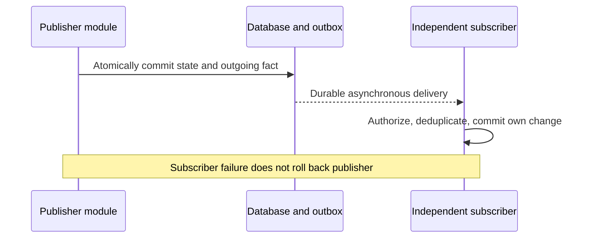

# Runtime choices and owning decisions

[Catalog](README.md) · [Selection route](selection.md) · Next: [Creation and evidence](delivery.md)

These are selection summaries, not implementation recipes. Each retained choice links its source contract and planned capability. Exact configuration, integration steps and checks belong to those capability pages when implemented. All executable support below remains unverified.

## Persistence and reads

**Scope:** data-owning module; host infrastructure contributes message persistence where needed.

| Choice | Choose / reconsider | Prerequisites and conflicts | Source / planned delivery |
| --- | --- | --- | --- |
| EF Core writes, PostgreSQL default | Start here unless SQL Server is required | Module owns mappings/context/migrations; rich models use aggregate repositories | [Persistence decision](https://github.com/lewan0996/arch-patterns/issues/7#issuecomment-5751875474), [#58](https://github.com/lewan0996/arch-patterns/issues/58) |
| SQL Server substitution candidate | Existing platform requirements justify provider change; reconsider migration/SQL portability | Separate provider-specific migration set and actual provider checks; PostgreSQL evidence does not verify this substitution | [Technology decision](https://github.com/lewan0996/arch-patterns/issues/13), [#76](https://github.com/lewan0996/arch-patterns/issues/76), [atomic local facts #77](https://github.com/lewan0996/arch-patterns/issues/77) |
| Parameterized SQL through EF raw SQL | Preferred SQL-first query path | Infrastructure implements Application-owned read access; query filters do not automatically protect raw SQL | [Persistence decision](https://github.com/lewan0996/arch-patterns/issues/7#issuecomment-5751875474), [#58](https://github.com/lewan0996/arch-patterns/issues/58) |
| Dapper reads | Explicit SQL/mapping tooling has value; reconsider extra dependencies | Same data ownership, parameters and authorization rules; flow profile unchanged | [Persistence decision](https://github.com/lewan0996/arch-patterns/issues/7#issuecomment-5751875474), [#79](https://github.com/lewan0996/arch-patterns/issues/79) |
| EF LINQ projections | Projection is clearer with EF; reconsider costly/opaque generated queries | Separate query shapes can use the owner's existing database; no separate read store implied | [Persistence decision](https://github.com/lewan0996/arch-patterns/issues/7#issuecomment-5751875474) |

Apply migrations explicitly as operational work, separate from application replicas. Do not read another owner's tables as an integration shortcut. Dedicated separate-read-database generation is [guidance-only](deferred.md).

## Identity and authorization

**Scope:** credential/session profile at entry boundaries; provider-neutral identity and request authorization at each receiving module.

| Choice | Choose / reconsider | Required boundary | Source / planned delivery |
| --- | --- | --- | --- |
| Browser session | Browser client needs session semantics | BFF or public monolith host owns session and server-side tokens; do not expose downstream tokens to browser code | [Security amendment](https://github.com/lewan0996/arch-patterns/issues/10#issuecomment-6884959269), [BFF #68](https://github.com/lewan0996/arch-patterns/issues/68), [monolith #69](https://github.com/lewan0996/arch-patterns/issues/69) |
| OAuth access token | Machine API or downstream API needs bearer identity | Validate issuer/audience; user authority and application authority are explicit; receiving service enforces authorization | [Authentication decision](https://github.com/lewan0996/arch-patterns/issues/10), [#64](https://github.com/lewan0996/arch-patterns/issues/64), [#67](https://github.com/lewan0996/arch-patterns/issues/67) |
| Token-carried permissions | Initial permission-source profile | Normalize claims into provider-neutral caller context; map external issuer/subject to stable internal user ID | [Permission-source amendment](https://github.com/lewan0996/arch-patterns/issues/13#issuecomment-6884598362), [#64](https://github.com/lewan0996/arch-patterns/issues/64) |
| Module-owned request authorization | Every protected use case, including non-HTTP entry | Direct-service decorators or CQRS middleware check normalized permissions and required resource/tenant facts before work; explicit allow-all rule for unrestricted requests | [Wolverine contract](https://github.com/lewan0996/arch-patterns/issues/52#issuecomment-6900052949), [direct #64](https://github.com/lewan0996/arch-patterns/issues/64), [CQRS #65](https://github.com/lewan0996/arch-patterns/issues/65) |

Choose an OAuth/OIDC-compatible identity provider with a reproducible local setup, not a vendor-dependent application model. A shared protected-resource audience across services requires an explicit trust-domain decision; common audience does not replace service authorization. Use delegated user authority for user operations and OAuth client credentials for application authority. Background consumers use assigned application authority.

Missing policies, trusted caller context or required facts deny protected work. Establish and clear trusted caller snapshots at boundary adapters; payload permissions and arbitrary broker headers are not trusted context. Concurrent requests must not share caller state. An authorization denial is not a transient failure. Reconsider coarse token permissions when resource ownership or freshness needs demand additional checks; application-managed assignments/projections and shared internal API keys remain [deferred](deferred.md).

## Communication and consistency

**Scope:** each data owner, independent subscriber, and operational host composing explicit routes.

| Choice | Choose / reconsider | Prerequisites / conflicts | Source / planned delivery |
| --- | --- | --- | --- |
| Durable local module facts | Modules in a shared host need decoupled reactions | State and outgoing envelope commit atomically; subscriber runs asynchronously in its own transaction; failure leaves publisher committed | [Final integration](https://github.com/lewan0996/arch-patterns/issues/52#issuecomment-6900052949), [direct #70](https://github.com/lewan0996/arch-patterns/issues/70), [CQRS #71](https://github.com/lewan0996/arch-patterns/issues/71) |
| Published integration events | Independently deployed peers react to committed facts | Explicit durable external routes, consumer-owned adapters/idempotency; no remote peer commands | [Event contract](https://github.com/lewan0996/arch-patterns/issues/20#issuecomment-5856978906) as amended by final integration; [Azure #73](https://github.com/lewan0996/arch-patterns/issues/73) |
| Service-local data copy | Local access justifies staleness and recovery responsibilities | State freshness expectation, bootstrap/rebuild and recovery; no cross-owner table access or generic projection engine | [Ownership amendment](https://github.com/lewan0996/arch-patterns/issues/11#issuecomment-6886035970), [#80](https://github.com/lewan0996/arch-patterns/issues/80) |

CQRS handlers primarily return storage/message effects with one transaction owner coordinating state and outbox. Direct services retain Application-owned publication interfaces and explicit infrastructure outbox integration. Ordinary imperative EF saving and Wolverine-managed saving are documented alternatives, not blanket generation/support promises. Saving then publishing independently is not atomic.

Host-owned message persistence must share the relevant relational transaction and have explicit schema/migration ownership. Reject configurations that cannot commit state and outgoing envelopes together. Use explicit durable local/external routes, independent destinations and destination-aware message identity when sharing a store. Required missing routes fail visibly; avoid implicit duplicate local/external handling.

Keep immutable business-event identity and envelope metadata through duplicate delivery and replay. Delivery is at least once; subscriber-owned business idempotency must survive beyond the native inbox window. No global ordering or exactly-once promise is made.

Technical processing failures receive two cooldown retries (200 ms, one second) then persistent failure storage; known permanent technical failures bypass retries. Business rejection is an explicit outcome. Operators inspect, repair and explicitly replay with original event identity. Counts apply per processing cycle. Local failures use database dead-letter storage without automatic expiration initially; external failures use the exact verified native transport dead-letter path. Retain unconfirmed outgoing work and surface failure-transfer outages.

Azure Service Bus is the production transport; RabbitMQ is local-development-only. Follow [local recovery #72](https://github.com/lewan0996/arch-patterns/issues/72), [Azure recovery #74](https://github.com/lewan0996/arch-patterns/issues/74), [RabbitMQ #75](https://github.com/lewan0996/arch-patterns/issues/75) and [SQL Server/Azure #78](https://github.com/lewan0996/arch-patterns/issues/78). Local success does not certify the managed production service. Cross-module transactions, saga engines and advanced redelivery profiles remain [deferred](deferred.md).

## Operational baseline

**Scope:** every operational boundary (shared host or independently deployed service); modules contribute domain signals.

| Choice | Choose / reconsider | Prerequisites / conflicts | Source / planned delivery |
| --- | --- | --- | --- |
| Process baseline | Required for every deployable | Structured logs, health/readiness, graceful shutdown, cancellation, validated external configuration and secret references | [Operations amendment](https://github.com/lewan0996/arch-patterns/issues/12#issuecomment-6893998851), [#57](https://github.com/lewan0996/arch-patterns/issues/57) |
| Bounded single HTTP attempt | Baseline remote call | Total time budget, timeout and caller cancellation; consumer owns adapter | [Resilience decision](https://github.com/lewan0996/arch-patterns/issues/22#issuecomment-5917789305), [#66](https://github.com/lewan0996/arch-patterns/issues/66) |
| Finite transient HTTP retries | Selected operation is safe to replay | Eligible transient failures only, within total caller budget; conflicts with unsafe replay | [Resilience decision](https://github.com/lewan0996/arch-patterns/issues/22#issuecomment-5917789305), [#66](https://github.com/lewan0996/arch-patterns/issues/66) |
| Local development and portable deployment | Required baseline | Dev Container owns toolchain/application execution; Compose supplies dependencies; portable OCI image; migrations run as separate operational jobs | [Operations decision](https://github.com/lewan0996/arch-patterns/issues/12), [#57](https://github.com/lewan0996/arch-patterns/issues/57) |
| Injected secrets and restart/replacement updates | Initial configuration/credential delivery | Values outside source and image; validate startup inputs; dynamic reload/live rotation optional | [Credential amendment](https://github.com/lewan0996/arch-patterns/issues/12#issuecomment-6893904538), [#57](https://github.com/lewan0996/arch-patterns/issues/57) |

Reconsider single attempts only where bounded safe retries improve an observed dependency failure mode. Reconsider a hosting platform when it cannot honor lifecycle, configuration or operational-job needs. Workload identity is preferred where platform/resource support it, but platform-specific integration, deployment automation and executable availability profiles remain [guidance-only follow-ups](deferred.md). Advanced telemetry is separate from the required structured logging baseline.
