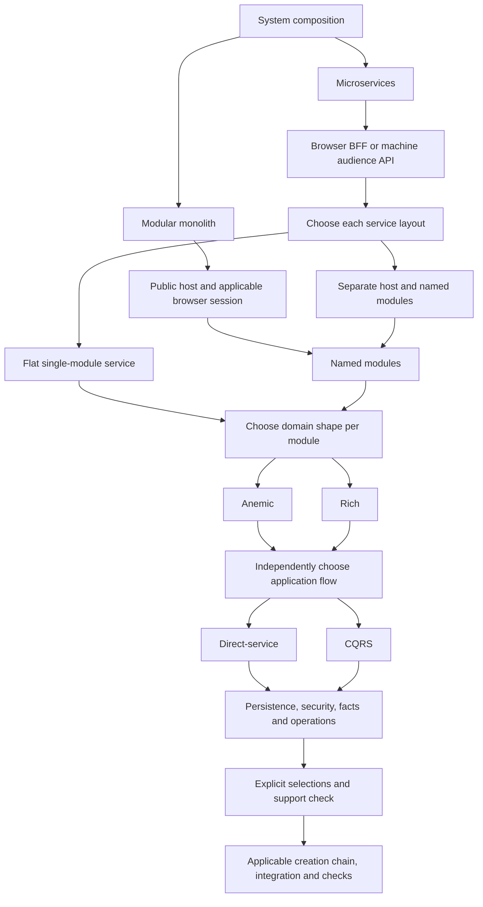

# Selection route

[Catalog](README.md) → composition → client-facing boundary → deployable layout → module choices → runtime → creation and checks.

1. [Choose system composition](structure.md#system-composition). Shared deployment favors the modular monolith; independently deployable boundaries must justify their extra operational cost. Neither domain richness nor CQRS decides this.
2. [Choose client-facing composition](structure.md#client-facing-composition). A monolith's host is normally public. In microservices, use the browser BFF or machine audience API for the relevant audience; both call services directly. A gateway remains optional guidance.
3. [Choose layout per service](structure.md#deployable-layout). A flat service already contains its sole module. Use a modular host for named internal boundaries. Adding a module to a flat service requires an explicitly designed conversion outside this creation workflow.
4. [Choose domain shape](modules.md#domain-model) and independently [application flow](modules.md#application-flow) for each module. Each module keeps one consistent flow profile. All four domain/flow pairs are conceptually compatible; their support evidence is separate.
5. [Choose persistence and reads](runtime.md#persistence-and-reads). Resolve database/provider/migration prerequisites. A separate read shape does not require a separate database or CQRS.
6. [Choose credentials and authorization](runtime.md#identity-and-authorization) at each entry point and protected use-case boundary. Identify user versus application authority and fail-closed rules before designing protected work.
7. [Choose fact routes and local copies](runtime.md#communication-and-consistency). A publisher's state and outgoing fact commit together; each subscriber commits independently. Specify recovery, idempotency and freshness where needed.
8. Apply the [operational baseline](runtime.md#operational-baseline) to every deployable and select bounded HTTP behavior for each remote call.
9. Write the explicit selections below. Follow the [native chains and AI integration contract](delivery.md#creation-chains), [examples](delivery.md#examples-and-evidence) and required checks. Available chains include the [host-free microservices solution](microservices-solution.md), [flat service](flat-service.md) and [PostgreSQL profile](direct-service-postgresql.md), with installation confined to a Dev Container/disposable CLI home. If a capability is still planned, continue to its owning ticket; this route does not certify it as runnable.

## Selection worksheet

Capture identities and choices at their owning scopes, rather than choosing a single architecture label for the whole system:

| Scope | Record explicitly |
| --- | --- |
| System | Boundary identity, modular-monolith or microservices composition, intended solution and client-facing boundaries |
| Each host | Boundary identity/location, flat or modular where applicable, public/session/token responsibilities, operational configuration |
| Each module (including a flat service's sole module) | Boundary identity/location, rich or anemic, direct-service or CQRS, database/provider, read tooling and migration ownership |
| Each interaction | HTTP or fact route, user/application authority, receiving authorization, persistence boundary, independent subscribers and idempotency; freshness/bootstrap/recovery for copies |
| Delivery | Catalog release, support status, native chain or explicit AI action, exact integration instructions and applicable passing evidence |

The [architecture-selection record](architecture-record.md) stores current selections in root `architecture.json` under the [schema contract](https://github.com/lewan0996/arch-patterns/issues/30#issuecomment-6112277799). Fresh solutions include a versioned schema and deterministic validator. Source owns actual dependency versions; Git owns history. Check affected boundaries for selection drift before creation and reconcile discrepancies explicitly. Do not mark a partial action successful or silently reinterpret a conflicting record.

Return to the [ingredient index](README.md) or inspect [guidance-only alternatives](deferred.md).
