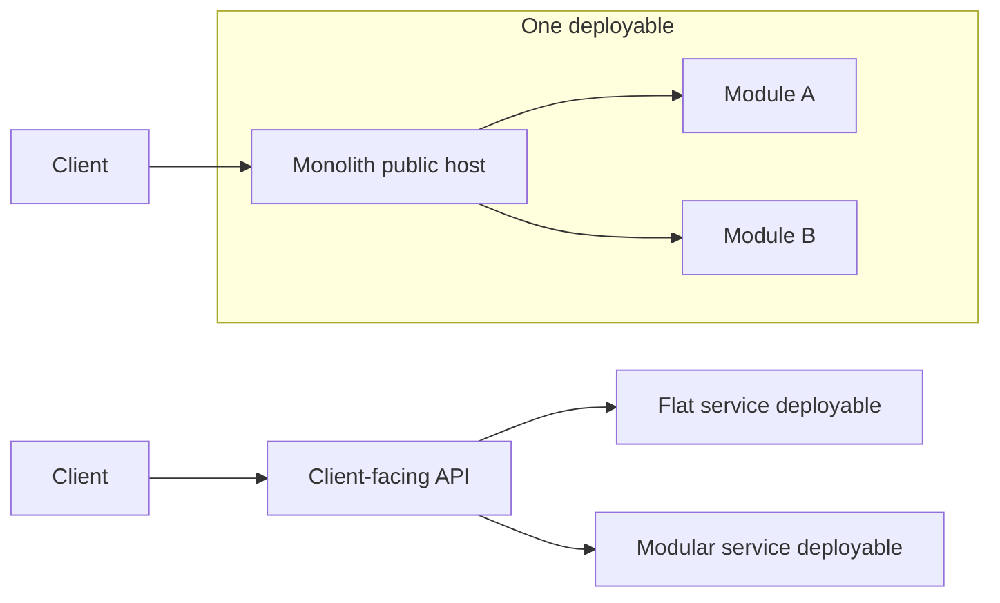

# System composition and deployable layout

[Catalog](README.md) · [Selection route](selection.md) · Next: [Module internals](modules.md)

## System composition

**Intent:** choose deployment boundaries independently of module internals.

| Option | Choose when | Reconsider when | Compatibility / prerequisites |
| --- | --- | --- | --- |
| Modular monolith | Shared deployment and simpler operations suit the system | Independent release, scaling or fault boundaries justify splitting deployments | Separate public API host composing named modules; may start with one module |
| Microservices | Independent deployment boundaries have a concrete benefit | Coordination and operational overhead exceed that benefit | Each service owns data and deployment; flat and modular services can coexist |

Both permit all four [domain/flow pairs](modules.md#compatible-combinations). A separate client does not make a monolith's modules independently deployable. A flat standalone-monolith template variant is outside the retained inventory.



**Support and source:** documented guidance; creation planned in [#59](https://github.com/lewan0996/arch-patterns/issues/59) for monoliths and [#56](https://github.com/lewan0996/arch-patterns/issues/56) for microservice solutions. The [combination decision](https://github.com/lewan0996/arch-patterns/issues/17#issuecomment-6241781558), subject to [current amendments](README.md#source-precedence), owns selection criteria and baselines. No verified runtime support is claimed.

## Client-facing composition

**Intent:** clients address one audience-shaped API without choosing internal services.

| Option / scope | Choose when | Reconsider / constraints | Planned delivery |
| --- | --- | --- | --- |
| Public monolith host / system | Modules share the public host | Separate BFF only with an explicit client need; not required by baseline | [Host #59](https://github.com/lewan0996/arch-patterns/issues/59), [browser sessions #69](https://github.com/lewan0996/arch-patterns/issues/69) |
| Browser BFF / client boundary | Browser needs a session-owning API and server-side tokens | Additional boundary is unnecessary for ordinary monolith browser hosting | [#68](https://github.com/lewan0996/arch-patterns/issues/68) |
| Machine audience API / client boundary | Machine clients need their audience's API | Avoid exposing internal service selection to each client | [#67](https://github.com/lewan0996/arch-patterns/issues/67) |
| Shared gateway / system | Shared routing behind client-facing APIs has a benefit | Adds a hop and operations; authentication responsibilities require their own selection | [Guidance-only #40](deferred.md) |

BFFs and audience APIs call services directly in the initial design. They provide authentication plumbing, not invented product endpoints. Receiving services still authorize operations; an edge check does not grant downstream access automatically. See [security](runtime.md#identity-and-authorization).

**Sources:** [composition amendment](https://github.com/lewan0996/arch-patterns/issues/9#issuecomment-6884342789) and [component decision](https://github.com/lewan0996/arch-patterns/issues/36). Exact integration/check instructions remain with the capability tickets; these are planned, not installed components.

## Deployable layout

**Intent:** choose internal boundaries within each microservice, without changing its independent deployment.

| Option | Choose when | Reconsider when | Compatibility / conflict |
| --- | --- | --- | --- |
| Flat single-module | One module is sufficient | Multiple named boundaries need explicit ownership | API owns host startup; adding a module requires conversion first |
| Modular microservice | Named internal boundaries are useful within one deployment | Separate deployment is actually needed, or module overhead brings no value | Separate API host plus named five-project modules; initial module required for completed service creation |

Illustrative responsibilities, not generated output:

```text
FlatService/
  Api/                 # endpoints and host composition
  Application/         # use cases and owned interfaces
  Domain/              # business model
  Infrastructure/      # persistence and external adapters
  Contract/            # public messages and query responses
ModularHost/
  Api/                 # process startup and module composition
  Modules/
    First/
      Api/             # module endpoints and transport mapping
      Application/
      Domain/
      Infrastructure/
      Contract/
    Second/            # same five responsibilities, separate owner
```

The modular monolith uses the same separate-host/named-module organization. Dependency directions are specified in [module responsibilities](modules.md#responsibilities-and-dependencies).

**Generation/integration:** native `arch-service` selects flat or modular layout. Modular service creation is host creation followed by `arch-module` for its first module; later modules use the same chain. AI actions must resolve layout explicitly; native single-module is the default. Conversion from flat to modular is not automatic. See [creation boundaries](delivery.md#creation-chains).

**Support and source:** [layout contract](https://github.com/lewan0996/arch-patterns/issues/28#issuecomment-6002994331); planned [flat #57](https://github.com/lewan0996/arch-patterns/issues/57) and [modular #60](https://github.com/lewan0996/arch-patterns/issues/60). No generated tree or passing executable fixture is asserted here.
